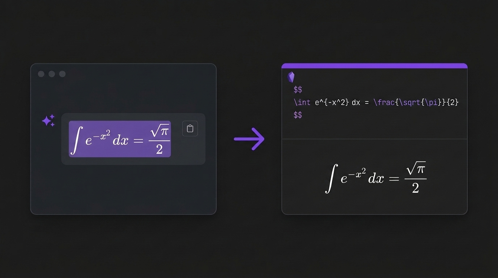
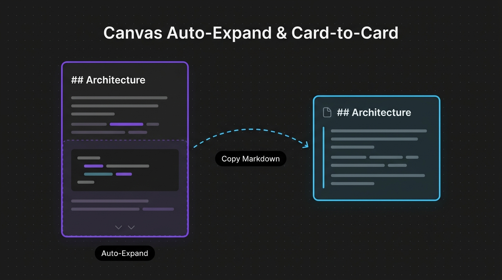
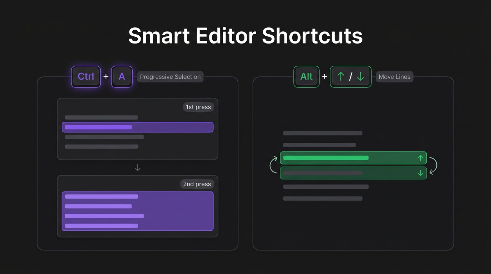

# Wiki Paste

> Seamless **LaTeX copy-paste**, **Canvas card automation**, and **smart editor shortcuts** for Obsidian.

---

## Features at a Glance

### 1. Copy & Paste LaTeX from Webpages and AI Chats

Copy rendered equations or Markdown responses directly from **ChatGPT, DeepSeek, Claude, Gemini, Wikipedia, Zhihu, GitHub, MathJax, or KaTeX** and paste them straight into Obsidian — no broken symbols, no duplicated text, and no escaped `$` signs.

- **Rendered Web Math → Obsidian**: Extracts KaTeX, MathJax v2/v3 (with pure MathML fallback), Wikipedia `.mwe-math-element`, Zhihu `data-tex`, and Gemini formulas into clean `$...$` and `$$...$$`.
- **AI Chat Delimiters**: Automatically converts `\(...\)` → `$...$` (trimmed for Obsidian) and `\[...\]` → `$$...$$` while skipping code blocks and inline code.
- **Internal Copy Safe**: Copying and pasting inside Obsidian stays untouched.

---

### 2. Canvas Auto-Expand & Card-to-Markdown / Card-to-Card

Work faster in **Obsidian Canvas** without manual resizing or clipboard loss.

- **Auto-Expand Pasted Cards**: Automatically measures rendered Markdown and expands pasted Canvas text cards so content fits cleanly without inner scrollbars.
- **Card-to-Markdown & Card-to-Card**: Copy or cut a single Canvas text card (`Ctrl+C` / `Ctrl+X`) and paste its exact Markdown directly into a **Markdown note** or **another Canvas card's editor**.

---

### 3. Smart Editor Shortcuts (`Ctrl+A` & `Alt + ↑ / ↓`)

Familiar editing ergonomics for both Markdown notes and Canvas text cards.

- **OneNote-Style `Ctrl+A`** (`Cmd+A` on macOS):
  - **1st press**: Selects the current line.
  - **2nd press**: Selects the entire note.
- **Move Selected Lines (`Alt + ↑` / `Alt + ↓`)**: Moves and swaps the current line or multi-line selection up or down while keeping your cursor/selection intact.

---

## Settings Overview

| Setting | Default | Description |
| --- | :---: | --- |
| **Convert and preserve pasted LaTeX** | ON | Converts web/AI math HTML and `\(...\)` / `\[...\]` to `$...$` / `$$...$$`. |
| **Auto-expand pasted Canvas cards** | ON | Resizes Canvas text cards after pasting so content is visible. |
| **Paste copied or cut Canvas cards to Markdown / Canvas card** | ON | Pastes a copied/cut Canvas text card into a note or another Canvas card. |
| **OneNote-style Ctrl+A (select line, then all)** | ON | Progressive `Ctrl+A` / `Cmd+A` selection in Markdown & Canvas editors. |
| **Move selected lines with Alt+Up/Down** | ON | Swap the current line or selected lines up/down with `Alt+ArrowUp` / `Alt+ArrowDown`. |
| **[Hack] Escape pasted Markdown syntax** | OFF | Legacy opt-in: escapes Markdown/Obsidian syntax in plain-text pastes. |
| **[Hack] Show paste options popup** | OFF | Prototype opt-in: shows a Word-style visual paste options menu. |
| **[Hack] Paste web content as raw HTML** | OFF | Experimental opt-in: inserts raw clipboard HTML unchanged. |

---

## Installation

1. Open **Settings → Community plugins → Browse** in Obsidian and search for **Wiki Paste**.
2. Click **Install**, then **Enable**.
3. Or download `main.js`, `manifest.json`, and `styles.css` from [GitHub Releases](https://github.com/hawaka6667-dev/obsidian-wiki-paste/releases) into `<vault>/.obsidian/plugins/wiki-paste/`.

---

## Feedback & Issue Reporting

Found a bug or want to request a feature?

- **Inside Obsidian**: Open **Settings → Wiki Paste → Support & feedback → Report issue**, or run the command **`Wiki Paste: Submit issue / feedback on GitHub`** from the Command Palette (`Ctrl+P`). Your plugin version, platform, and enabled options are pre-filled automatically.
- **On GitHub**: [Open an Issue](https://github.com/hawaka6667-dev/obsidian-wiki-paste/issues/new).
